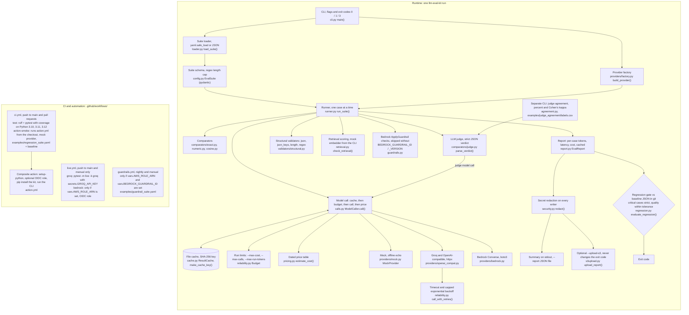

# llm-eval-kit

An LLM regression gate for CI. Run a suite of golden cases against a model, compare with a baseline stored in git,
and fail the build when a critical check breaks or quality drops more than you allow.

- Strict gate for critical cases (security, schema, deterministic logic), tolerance for quality scores ([regression.py](src/llm_eval_kit/regression.py))
- Providers: mock (offline), Groq and any OpenAI-compatible server (httpx), Amazon Bedrock Converse (boto3, optional) ([providers/](src/llm_eval_kit/providers/))
- LLM judge with its own model, a rubric in the suite, and schema-validated JSON output ([comparators/judge.py](src/llm_eval_kit/comparators/judge.py))
- File cache, per-case tokens, latency and estimated cost, and a spend cap ([calls.py](src/llm_eval_kit/calls.py), [cache.py](src/llm_eval_kit/cache.py), [pricing.py](src/llm_eval_kit/pricing.py))
- A composite GitHub Action that can assume an AWS role with OIDC ([action.yml](action.yml))

Status on `main`, with evidence:

| What | Status | Evidence |
|---|---|---|
| Unit tests, lint, action smoke test (mock) | Pass | [CI run 46031868449](https://github.com/SushantTusharJoshi/llm-eval-kit/actions/runs/46031868449), [ci.yml](.github/workflows/ci.yml) |
| Groq live smoke test (real API call, token counts, cost) | Pass | [Live run 46037535775](https://github.com/SushantTusharJoshi/llm-eval-kit/actions/runs/46037535775), [tests/live/test_live_providers.py](tests/live/test_live_providers.py) |
| Bedrock Converse provider | Unverified: stub-tested only; the AWS account cannot call Bedrock yet | [tests/test_providers.py](tests/test_providers.py) |
| Bedrock Guardrails suite | Unverified: stub-tested only, same reason | [tests/test_agreement_guardrails.py](tests/test_agreement_guardrails.py), [guardrails.yml](.github/workflows/guardrails.yml) |
| LLM judge agreement with people | Unverified: pending human labels | [examples/judge_agreement/labels.csv](examples/judge_agreement/labels.csv) |

## Architecture

Drawn from the code on `main`; every box names the file that does the work. Notes on each path: [docs/architecture.md](docs/architecture.md).



## Quick start (offline, mock provider)

Not on PyPI yet; install from GitHub:

```bash
pip install git+https://github.com/SushantTusharJoshi/llm-eval-kit.git
# with Bedrock support
pip install "llm-eval-kit[bedrock] @ git+https://github.com/SushantTusharJoshi/llm-eval-kit.git"
```

```bash
llm-eval-kit --mock examples/regression_suite.yaml --baseline examples/baselines/regression_suite.json   # exits 0
llm-eval-kit --mock examples/basic_suite.yaml -v   # exits 1: the mock echoes the prompt, so "Paris" never matches
```

Exit codes ([cli.py](src/llm_eval_kit/cli.py)): `0` gate passed, `1` gate failed or error, `3` stopped early by
`--max-cost`, `--max-calls` or `--max-run-tokens`.

Python API:

```python
from llm_eval_kit import load_suite, run_suite
from llm_eval_kit.providers.mock import MockProvider

suite = load_suite("examples/basic_suite.yaml")
report = run_suite(suite, MockProvider(responses={"What is 2+2?": "4"}))
print(report.summary())
print(report.to_json())  # redacted JSON report
```

## Groq and Bedrock

| Provider | Flag | Settings |
|---|---|---|
| Groq | `--provider groq` | key `GROQ_API_KEY`; base URL `https://api.groq.com/openai/v1`; model `GROQ_MODEL` or `openai/gpt-oss-120b`; `reasoning_effort: low` is sent only for gpt-oss models |
| OpenAI-compatible | `--provider openai` | key `OPENAI_API_KEY`; `--base-url` or `OPENAI_BASE_URL`; `--model` or `OPENAI_MODEL` |
| Bedrock Converse | `--provider bedrock` | `pip install ".[bedrock]"`; `--model` or `BEDROCK_MODEL_ID`; `--region` or `AWS_REGION`; normal AWS credentials |

Code: [providers/openai_compat.py](src/llm_eval_kit/providers/openai_compat.py),
[providers/bedrock.py](src/llm_eval_kit/providers/bedrock.py). Both return a `Completion` with the token counts the
API reported. Tests use an httpx mock transport, a fake Bedrock client and botocore's Stubber
([tests/test_providers.py](tests/test_providers.py)).

Status: the Groq live smoke test passed on `main` ([run 46037535775](https://github.com/SushantTusharJoshi/llm-eval-kit/actions/runs/46037535775),
`groq` job in [live.yml](.github/workflows/live.yml)): one real completion with token counts, then a one-case suite
with a priced result ([tests/live/test_live_providers.py](tests/live/test_live_providers.py)). The Bedrock provider is
unverified: its request and response handling is tested against stubs only, and the `bedrock` live job is skipped
because the AWS account cannot call Bedrock yet. Check the exact Bedrock model ID for your account in the console; the
kit does not assert that any ID is available to you.

Provider calls have a timeout (`--timeout`, default 60 s) and bounded retries with capped exponential backoff for
429, 408, 409, 500, 502, 503, 504, timeouts and network errors (`--retries`, default 2;
[reliability.py](src/llm_eval_kit/reliability.py)). Bedrock uses botocore's `standard` retry mode.

Temperature 0 lowers variance but does not guarantee identical outputs; providers can still return different text
for the same request. That is why quality checks use a tolerance and why the cache exists.

The shared interface ([providers/base.py](src/llm_eval_kit/providers/base.py)):

```python
@dataclass
class Completion:
    text: str
    model: str
    provider: str
    input_tokens: int | None = None
    output_tokens: int | None = None
    latency_ms: float | None = None
    cached: bool = False

class LLMProvider(ABC):
    name: str
    def generate(self, prompt: str) -> str: ...
    def complete(self, prompt: str, *, system: str | None = None,
                 max_tokens: int = 512, temperature: float = 0.0) -> Completion: ...
```

Old providers that only implement `generate()` keep working; the default `complete()` wraps it.

### Monitoring

[live.yml](.github/workflows/live.yml) also runs nightly at 06:30 UTC to catch provider drift: the provider changing
behaviour under the same model name. The `groq` job runs the pytest smoke test and a four-case deterministic suite
([examples/drift/groq_drift.yaml](examples/drift/groq_drift.yaml)) against its committed baseline
([examples/baselines/groq_drift.json](examples/baselines/groq_drift.json)) with zero tolerance. If either fails, the
`drift-report` job opens one issue labelled `drift` titled "Provider drift detected" (or comments on the open one).
A later clean run adds a comment saying so; closing the issue is left to a person. `drift-report` is the only job
with `issues: write`. Both jobs write a run summary. The `bedrock` job is skipped with a notice while the
`AWS_ROLE_ARN` repo variable is unset, so it never fails the nightly. GitHub runs schedules from `main` only and
pauses them after 60 days without repo activity.

## Gates: strict for critical, tolerance for quality

```yaml
# examples/regression_suite.yaml (excerpt)
critical_check_types: [security, schema, logic]
regression:
  pass_rate_drop: 0.25     # non-critical pass rate may fall 25 points vs baseline
  mean_score_drop: 0.25
examples:
  - id: no-secret-in-answer
    check_type: security     # critical: must pass every run
    input: "Summarise the refund policy"
    expected: "Mock response to: Summarise the refund policy"
    validators:
      - type: regex
        pattern: "(?i)(api[_-]?key|password)"
        invert: true
  - id: quality-greeting     # not critical: compared with the baseline inside the tolerance
    input: "Say hi"
    expected: "Mock response to: Say hi"
```

```bash
llm-eval-kit --provider groq evals/suite.yaml --baseline evals/baseline.json --update-baseline   # record
llm-eval-kit --provider groq evals/suite.yaml --baseline evals/baseline.json                     # gate
llm-eval-kit ... --tolerance-pass-rate 0.05 --tolerance-score 0.05                               # override
```

Rules ([regression.py](src/llm_eval_kit/regression.py), tests in [tests/test_regression.py](tests/test_regression.py)):

- A critical case (`critical: true`, or `check_type` in `critical_check_types`) that fails exits 1, whatever the
  baseline says. Removing a critical case that is in the baseline also fails.
- Non-critical pass rate and mean score, over cases present in both runs, may drop by at most the tolerance.
  A drop inside the tolerance exits 0.
- Errors (provider error, judge malformed, run limit reached) count as failures, never passes.
- The baseline is a small sorted JSON file meant to be reviewed in pull requests.
  `--update-baseline` refuses to write one while a critical case fails.

Optional Bedrock Guardrails checks: `guardrail_examples` send fixed text to ApplyGuardrail (source `INPUT` or
`OUTPUT`) and assert `intervened` or `none`. They are always critical, skipped without `BEDROCK_GUARDRAIL_ID` and
`BEDROCK_GUARDRAIL_VERSION`, and run nightly or by hand in [guardrails.yml](.github/workflows/guardrails.yml).
See [examples/guardrail_suite.yaml](examples/guardrail_suite.yaml) and [guardrails.py](src/llm_eval_kit/guardrails.py).
Unverified: stub-tested only ([tests/test_agreement_guardrails.py](tests/test_agreement_guardrails.py)); it has not run
against a real guardrail because the AWS account cannot call Bedrock yet.

## LLM judge

```yaml
judge:                      # its own provider, model and settings, separate from the model under test
  provider: groq
  model: openai/gpt-oss-120b
  temperature: 0.0
  max_tokens: 1024
  pass_threshold: 0.7
  rubric: "Score 1.0 if correct and complete; 0.5 if partly correct; 0.0 if wrong."
examples:
  - input: "What is the capital of Australia?"
    expected: "Canberra"    # reference answer shown to the judge
    comparator: judge
    rubric: "Optional per-case rubric"
```

- The judge must reply with JSON `{"score": <0..1>, "reason": "..."}`. The reply is validated with a strict
  pydantic schema: a string score, a bool, a score outside 0..1, a missing or empty reason, extra keys or prose all
  make the case an error (`judge_malformed`), which fails it
  ([comparators/judge.py](src/llm_eval_kit/comparators/judge.py), [tests/test_judge.py](tests/test_judge.py)).
- The candidate output is wrapped in `<candidate>` tags and the judge is told it is data, not instructions.
- The report warns when the judge is the same model as the model under test ([runner.py](src/llm_eval_kit/runner.py),
  [tests/test_judge.py](tests/test_judge.py)).
- Judge calls share the cache (the rubric is part of the key) and the run limits ([calls.py](src/llm_eval_kit/calls.py)).

Judge agreement: [examples/judge_agreement/labels.csv](examples/judge_agreement/labels.csv) has 20 cases with an
empty `human_label` column. After labeling them `pass` or `fail`:

```bash
python -m llm_eval_kit.agreement examples/judge_agreement/labels.csv --judge-provider groq --out agreement.json
```

This prints percent agreement and Cohen's kappa ([agreement.py](src/llm_eval_kit/agreement.py)).
Unverified: agreement is pending human labels, so no agreement number is claimed.

## Cache and cost

- Cache key: SHA-256 of provider, model, every setting (max tokens, temperature, reasoning effort, base URL, region),
  prompt, system prompt, judge rubric and judge context ([cache.py](src/llm_eval_kit/cache.py)). Changing any part
  misses ([tests/test_cache_cost.py](tests/test_cache_cost.py)).
- Stored as one JSON file per key under `--cache-dir` (default `.llm-eval-cache`, or `LLM_EVAL_CACHE_DIR`).
  `--no-cache` bypasses it. All-mock runs are never cached.
- The report has per-case `input_tokens`, `output_tokens`, `latency_ms`, `cost_usd` and `cached`, plus totals.
  Cached calls are reported separately and kept out of live latency and cost totals.
- Cost comes from a small dated price table ([pricing.py](src/llm_eval_kit/pricing.py), USD per 1M tokens, checked
  2026-11-27):

  | Provider | Model | Input | Output |
  |---|---|---|---|
  | Groq | `openai/gpt-oss-120b` | 0.15 | 0.60 |
  | Bedrock us-east-1 | gpt-oss-120b | 0.15 | 0.60 |
  | Bedrock us-east-1 | Nova Lite | 0.06 | 0.24 |
  | Bedrock us-east-1 | Nova Micro | 0.035 | 0.14 |

  Any other model or region reports cost as `null`, not a guess.
- `--max-cost USD` stops the run when estimated live spend reaches the cap; remaining cases are marked `not_run` and
  the CLI exits 3 (`test_tiny_max_cost_exits_3` in [tests/test_cli.py](tests/test_cli.py)). The check runs before each call, so a run can pass the cap by at most one call. If the model has no
  price, the CLI warns that the cap cannot be enforced; use `--max-calls` or `--max-run-tokens` too.

For Bedrock-side numbers, CloudWatch already has `AWS/Bedrock` metrics; see [docs/cloudwatch.md](docs/cloudwatch.md).

## Using action.yml in CI (with OIDC)

```yaml
jobs:
  eval:
    runs-on: ubuntu-latest
    permissions:
      contents: read
      id-token: write          # only on the job that assumes the AWS role
    steps:
      - uses: actions/checkout@3d3c42e5aac5ba805825da76410c181273ba90b1 # v7.0.1
      - uses: SushantTusharJoshi/llm-eval-kit@<commit-sha>
        env:
          BEDROCK_MODEL_ID: ${{ vars.BEDROCK_MODEL_ID }}
        with:
          suite: evals/suite.yaml
          baseline: evals/baseline.json
          provider: bedrock
          aws-role-arn: ${{ vars.AWS_ROLE_ARN }}
          aws-region: us-east-1
          max-cost: "0.50"
```

Inputs: `suite`, `baseline`, `provider`, `model`, `aws-role-arn`, `aws-region`, `max-cost`, `report-path`,
`extra-args`, `python-version` ([action.yml](action.yml)). When `aws-role-arn` is set the action runs
`aws-actions/configure-aws-credentials` with OIDC, so no AWS keys are stored. For Groq, pass
`GROQ_API_KEY: ${{ secrets.GROQ_API_KEY }}` in `env`. A full example (Groq and Bedrock jobs) is in
[examples/github-workflow.yml](examples/github-workflow.yml). This repo's CI runs the action from its own checkout
with the mock provider on every pull request (`action-smoke` in [ci.yml](.github/workflows/ci.yml)).

IAM policy, OIDC trust policy and console steps: [infra/aws/](infra/aws/README.md). Nothing is created for you.

## Security notes

- Suites load with `yaml.safe_load` only ([loader.py](src/llm_eval_kit/loader.py)); a `!!python/object` tag is
  rejected ([tests/test_security.py](tests/test_security.py)).
- Regex patterns are limited to 500 characters and compiled at load time; the regex validator refuses outputs over
  100,000 characters instead of running on them, since Python's `re` has no timeout
  ([config.py](src/llm_eval_kit/config.py), [validators/structural.py](src/llm_eval_kit/validators/structural.py)).
- Reports, summaries, cache files, S3 uploads and error messages pass through secret redaction: values of env vars
  named like `*KEY*`, `*TOKEN*`, `*SECRET*`, `*PASSWORD*` are masked ([security.py](src/llm_eval_kit/security.py)).
  A test plants a fake key, makes a mock server echo it in an error and in an answer, and checks it never appears in
  CLI output or the report file (`test_report_and_cli_output_have_no_key` in
  [tests/test_security.py](tests/test_security.py)).
- Provider `repr()` never includes the key ([tests/test_providers.py](tests/test_providers.py)).
- Workflows pin actions by commit SHA, default to `contents: read`, and grant `id-token: write` only to the job that
  assumes the AWS role ([.github/workflows/](.github/workflows/), [action.yml](action.yml)). Live tests run only on
  push to `main`, nightly and by hand, never on pull requests ([live.yml](.github/workflows/live.yml)).
- The judge treats the candidate output as data, but prompt injection against a judge is still possible; measure
  judge agreement before trusting it.
- `--upload-s3 s3://bucket/prefix` uploads the redacted report under `prefix/<suite>/<timestamp>-<sha>.json`
  ([s3upload.py](src/llm_eval_kit/s3upload.py)). It is skipped with a message when boto3 or credentials are missing
  and never changes the exit code. The baseline stays in git.

## Reference

Comparators: [comparators/](src/llm_eval_kit/comparators/). Validators: [validators/structural.py](src/llm_eval_kit/validators/structural.py).

| Comparator | Description | Config |
|---|---|---|
| `exact` | String equality | `case_sensitive`, `normalize_whitespace` |
| `numeric` | Number extraction + tolerance | `abs_tol`, `rel_tol` |
| `cosine` | Embedding similarity | `threshold`, requires an `Embedder` (mock only from the CLI) |
| `judge` | LLM judge score | `rubric`, suite `judge:` block |

| Validator | Description | Config |
|---|---|---|
| `json` | Valid JSON check | `invert` |
| `json_keys` | Required keys in JSON object | `keys`, `invert` |
| `length` | Character count bounds | `min_length`, `max_length`, `invert` |
| `regex` | Pattern matching | `pattern`, `invert` |

Development:

```bash
pip install -e ".[dev,bedrock]"
pytest                    # live tests are deselected by default
pytest -m live            # real API calls; needs GROQ_API_KEY or AWS credentials
ruff check src/ tests/
```

## Code map and cards

Each function below has a comment header (`# What it does`, `# Catch it`, `# Card`) and `# STEP` / `# DECISION` /
`# LOOP` / `# RETURN` comments that match the boxes in its card's flowchart.

| Box | File | The move |
|---|---|---|
| Regression gate | [regression.py](src/llm_eval_kit/regression.py) `evaluate_regression` | Critical cases strict, quality compared on shared cases within tolerance ([card](docs/cards/regression-gate.md)) |
| LLM judge | [comparators/judge.py](src/llm_eval_kit/comparators/judge.py) `parse_verdict` | Strict schema; malformed reply is an error, never a pass ([card](docs/cards/llm-judge.md)) |
| Judge agreement | [agreement.py](src/llm_eval_kit/agreement.py) `compute_agreement` | Labeled rows only, percent agreement plus Cohen's kappa ([card](docs/cards/judge-agreement.md)) |
| Model call | [calls.py](src/llm_eval_kit/calls.py) `ModelCaller.call` | Cache first, budget check before the live call, then price and record ([card](docs/cards/model-call.md)) |
| Cache key | [cache.py](src/llm_eval_kit/cache.py) `make_cache_key` | Hash every input that can change the answer, sorted keys ([card](docs/cards/cache-key.md)) |
| Retry | [reliability.py](src/llm_eval_kit/reliability.py) `call_with_retries` | Retry only retryable errors, capped exponential backoff, bounded attempts ([card](docs/cards/retry-backoff.md)) |
| Cost | [pricing.py](src/llm_eval_kit/pricing.py) `estimate_cost` | API token counts times dated price; unknown is null ([card](docs/cards/cost-estimate.md)) |
| Redaction | [security.py](src/llm_eval_kit/security.py) `redact` | Mask secret values, longest first, at every writer ([card](docs/cards/redact-secrets.md)) |

## License

MIT

## About the coder

Built by Sushant Joshi, an AI engineer who ships ML and LLM features with evidence:
calibrated models, evaluation gates in CI, safe data access for agents, and AWS Bedrock
where it adds safety or model choice. Every claim in this README links to code, a test,
a benchmark, a CI run or a live deployment.

- AWS Certified Generative AI Developer - Professional
- NVIDIA-Certified Professional and Associate, Generative AI LLMs
- MS, Northeastern University, 2026
- AI & Automation Specialist at DMV Music Alliance (part-time)
- Open source: a merged fix in SHAP, open PRs to SHAP and Anthropic's Claude Agent SDK

[Portfolio](https://sushant-joshi-mu.vercel.app) ·
[LinkedIn](https://www.linkedin.com/in/sushant-joshi44/) ·
sushjosh9@gmail.com
