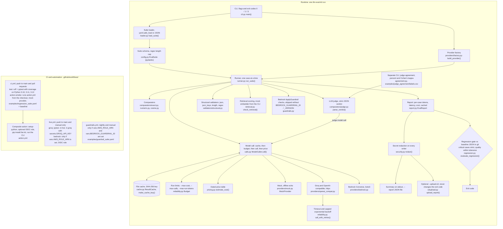

# Architecture

How one `llm-eval-kit` run travels through the code on `main`, and what the workflows run. Every box names the file that does the work (paths under `src/llm_eval_kit/` unless shown).

Notes, each checked against the code:

- The runner and the judge both call models through `ModelCaller`, so cache hits, the spend cap and the usage totals treat them the same way ([calls.py](../src/llm_eval_kit/calls.py)). The budget is checked before each live call; cache hits do not touch it.
- All-mock runs are never cached ([cli.py](../src/llm_eval_kit/cli.py)). The CLI passes an embedder only for the mock provider, so `cosine` cases and retrieval checks need `--provider mock` from the command line ([cli.py](../src/llm_eval_kit/cli.py), [comparators/__init__.py](../src/llm_eval_kit/comparators/__init__.py)).
- The Bedrock provider relies on botocore's `standard` retry mode instead of `call_with_retries` ([providers/bedrock.py](../src/llm_eval_kit/providers/bedrock.py)).
- `--update-baseline` writes the baseline only when no critical case fails ([cli.py](../src/llm_eval_kit/cli.py), [regression.py](../src/llm_eval_kit/regression.py)).
- In the workflows, only the `bedrock` job in `live.yml` and the `guardrails` job get `id-token: write`; everything else runs with `contents: read`.
