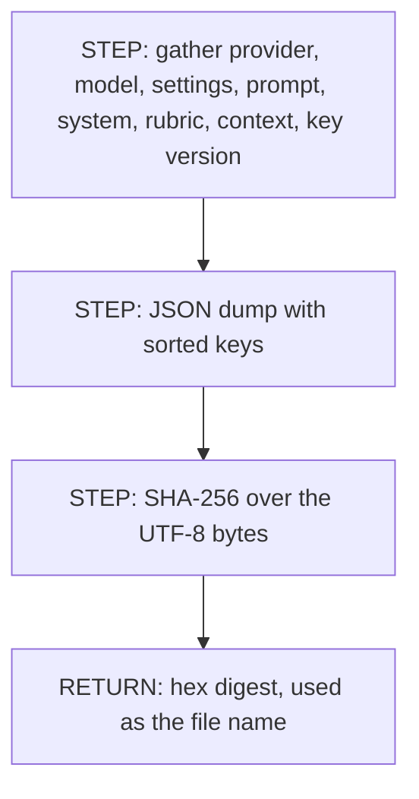

# Card: cache key for LLM calls

Code: `make_cache_key` in [src/llm_eval_kit/cache.py](../../src/llm_eval_kit/cache.py).
Tests: `TestCacheKey` in [tests/test_cache_cost.py](../../tests/test_cache_cost.py) (changing any part misses).

## The question

"Design a cache for LLM calls. What goes in the key so you never serve a stale answer?"

## How to catch it in an interview

Listen for: memoize, avoid paying twice, speed up CI re-runs. The answer: the key is a hash of every input that can
change the output, serialised in a stable order, plus a version so you can invalidate everything at once.

## Flowchart

## Slips (what this change fixed)

- Settings include provider-specific ones (`reasoning_effort`, `base_url`, region), not just temperature and max tokens.
  A key without them would serve a low-effort answer to a high-effort request.
- The judge rubric is part of the key, so editing a rubric re-runs the judge.
- `sort_keys=True` makes the key independent of dict order (tested).
- The API key is never part of the key or the cached file; cached text is redacted on write.

## Interviewer questions and how the code answers

| Question | Answer in the code |
|---|---|
| Why hash instead of using the prompt as a key? | Fixed length, safe file name, and no prompt text in paths. |
| How do you bust the whole cache? | Bump `CACHE_KEY_VERSION`. |
| Corrupt file? | `ResultCache.get` treats it as a miss, never an error. |
| Does caching hide flakiness? | It can; `--no-cache` bypasses it, and temperature 0 is still not a determinism guarantee. |

## Twists

- Add a TTL by storing a timestamp and treating old entries as misses.
- Share the cache in CI with `actions/cache`, keyed on the suite file hash.
- Content-address the model too: providers can silently update a model behind the same ID.
