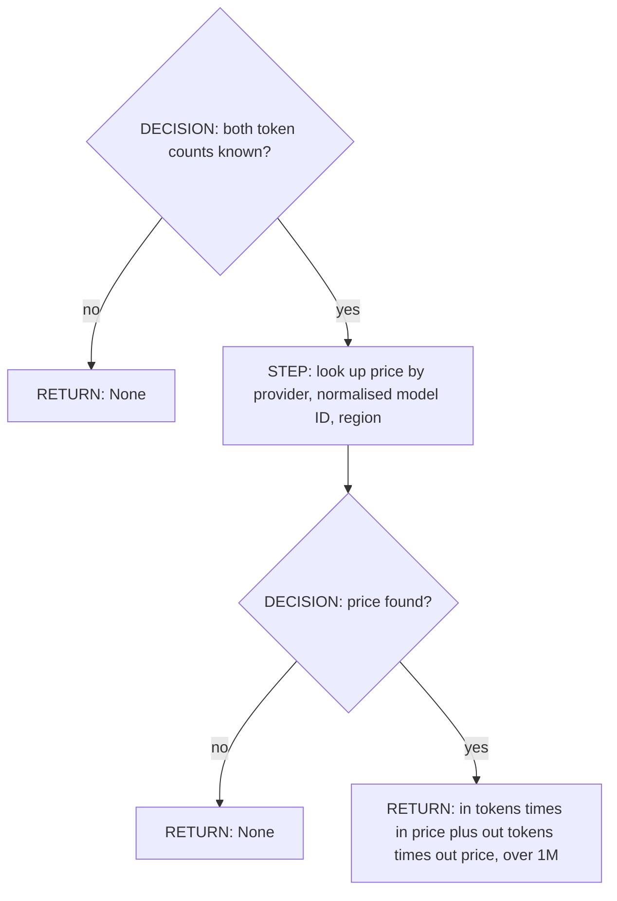

# Card: cost estimate with an honest unknown

Code: `estimate_cost` in [src/llm_eval_kit/pricing.py](../../src/llm_eval_kit/pricing.py).
Tests: `TestPricing` and `TestReportUsage` in [tests/test_cache_cost.py](../../tests/test_cache_cost.py).

## The question

"Estimate what this eval run cost, and say what you do when you do not know the price."

## How to catch it in an interview

Listen for: cost per run, token accounting, FinOps. The answer: tokens from the API response times a dated price
table, and `None` (null) when the model or the counts are unknown, never a guess.

## Flowchart

## Slips (what this change fixed)

- Before: no token counts or cost at all in the report.
- Bedrock prices are tied to us-east-1; another region reports null instead of a wrong number.
- Inference-profile prefixes (`us.`, `eu.`) are stripped so `us.amazon.nova-micro-v1:0` still matches.
- Cached calls are priced but reported separately and kept out of live totals.

## Interviewer questions and how the code answers

| Question | Answer in the code |
|---|---|
| Where do token counts come from? | The API response: `usage.prompt_tokens` (OpenAI style) or `usage.inputTokens` (Converse). |
| Why a date on the table? | Prices change; `PRICES_CHECKED_ON` is written into every report. |
| Why not estimate tokens with a tokenizer? | Different models tokenize differently; the API count is the billed count. |

## Twists

- Reasoning models bill hidden reasoning tokens as output; the API count already includes them.
- Add cached-input pricing for providers with prompt caching.
- Load prices from a file so they can be updated without a release.
