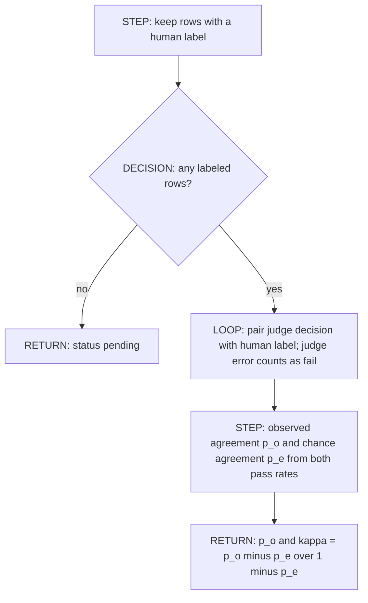

# Card: does the judge agree with humans?

Code: `compute_agreement` in [src/llm_eval_kit/agreement.py](../../src/llm_eval_kit/agreement.py).
Sheet: [examples/judge_agreement/labels.csv](../../examples/judge_agreement/labels.csv) (20 rows, `human_label` empty).
Tests: `TestAgreement` in [tests/test_agreement_guardrails.py](../../tests/test_agreement_guardrails.py).

Status: pending. The owner labels the sheet; no agreement number is claimed until then.

## The question

"How do you know your LLM judge is any good?"

## How to catch it in an interview

Listen for: "can we trust the grader", calibration, human eval. The answer: a small human-labeled set, run the judge on
the same fixed outputs, report percent agreement and Cohen's kappa (agreement corrected for chance).

## Flowchart

## Slips (what this change fixed)

- Unlabeled rows are ignored instead of counted as fails.
- A judge error is never silently dropped: it counts as a fail and is reported in `n_judge_errors`.
- Kappa is None when both sides gave a single answer for every row (p_e is 1), instead of dividing by zero.
- With zero labels the CLI prints pending and makes no judge calls.

## Interviewer questions and how the code answers

| Question | Answer in the code |
|---|---|
| Why kappa and not just accuracy? | If 90% of rows pass, a judge that always says pass gets 90% agreement and kappa 0. |
| How many labels? | 20 is a smoke check; widen it before trusting small differences. |
| How to run it? | `python -m llm_eval_kit.agreement examples/judge_agreement/labels.csv --judge-provider groq` |

## Twists

- Use score thresholds: sweep `pass_threshold` and pick the one with the best kappa.
- Two human labelers first: their kappa is the ceiling for the judge.
- Track agreement per rubric; a judge can be good at facts and bad at tone.
