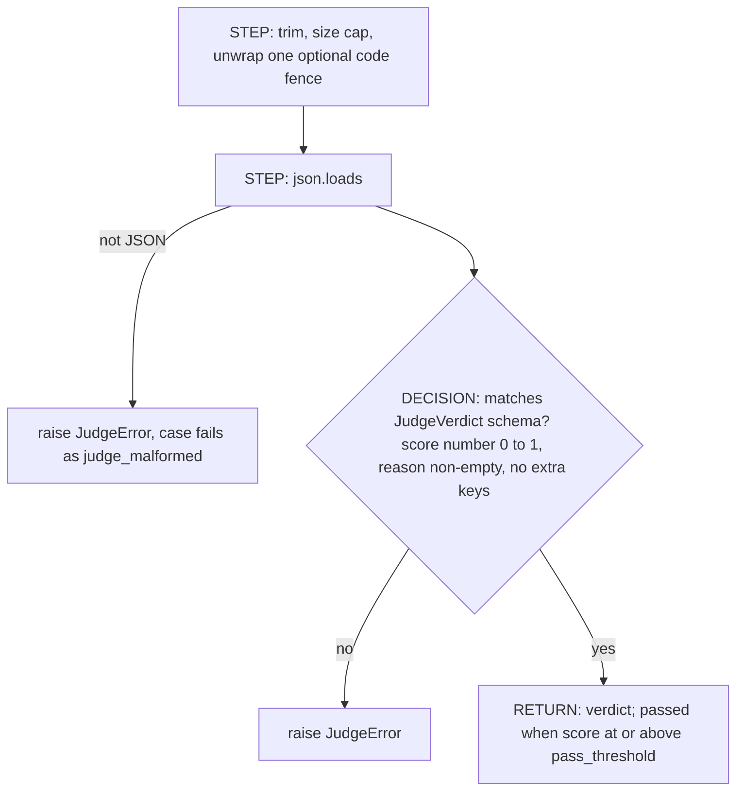

# Card: LLM judge with a schema, where garbage fails

Code: `parse_verdict` and `JudgeComparator` in [src/llm_eval_kit/comparators/judge.py](../../src/llm_eval_kit/comparators/judge.py).
Tests: [tests/test_judge.py](../../tests/test_judge.py) (12 malformed replies, all rejected; stub judge provider).

## The question

"You use an LLM to grade another LLM. What happens when the grader returns garbage?"

## How to catch it in an interview

Listen for: LLM-as-judge, rubric grading, "score open-ended answers". The answer: separate judge model, a rubric in
the suite, a strict output schema, and a malformed reply is an error that fails the case. Never default to pass.

## Flowchart

## Slips (what this change fixed)

- No regex hunting for a number in prose: `"Score: 0.9"` is malformed, not 0.9.
- `strict=True` on the score rejects `"0.9"` and `true` (a bool is an int in Python).
- The judge has its own provider, model, temperature and max tokens (`judge:` block). The suite's settings for the
  model under test never leak into it (tested). A warning is added when the judge is the same model.
- The candidate output is wrapped in `<candidate>` tags and the system prompt says it is data, not instructions.
- Judge calls go through the same cache and budget; the rubric is part of the cache key.

## Interviewer questions and how the code answers

| Question | Answer in the code |
|---|---|
| Why a separate judge model? | Self-preference bias; `run_suite` warns if judge and model match. |
| Malformed output? | `error="judge_malformed"`, `passed=False`, gate fails. |
| How do you trust the judge? | Measure agreement with human labels (see judge-agreement card). |
| Prompt injection from the candidate? | Delimited and declared as data; still a known risk, which is why agreement is measured. |

## Twists

- Use the provider's JSON mode or tool calling to force structure, and keep the schema check anyway.
- Pairwise judging (A vs B) instead of absolute scores reduces scale drift.
- Ask for the reason before the score to reduce anchoring.
