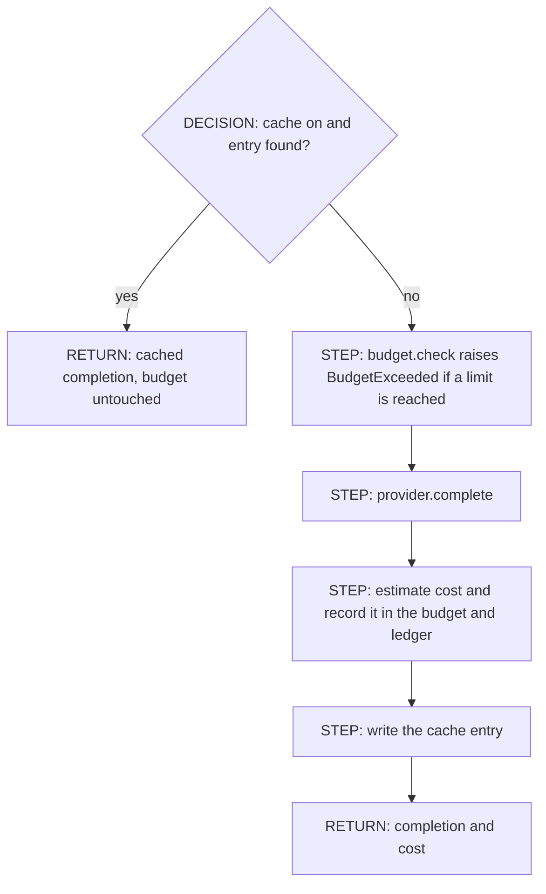

# Card: one door for every model call

Code: `ModelCaller.call` in [src/llm_eval_kit/calls.py](../../src/llm_eval_kit/calls.py).
Tests: `TestModelCaller` and `test_tiny_spend_cap_stops_run_cleanly` in [tests/test_cache_cost.py](../../tests/test_cache_cost.py), `test_tiny_max_cost_exits_3` in [tests/test_cli.py](../../tests/test_cli.py).

## The question

"Add a spend cap to a batch job that calls a paid API. Where do you check it, and do cache hits count?"

## How to catch it in an interview

Listen for: budget, cost control, quota, "stop before we spend too much". The trick is to put the check in the
one place every call goes through, check before the call, and charge only real calls.

## Flowchart

## Slips (what this change fixed)

- Before: the runner called `provider.generate` directly, so there was no place to add caching, limits or cost.
- Cache hits skip the budget; a re-run of a cached suite costs nothing and is never stopped.
- The check runs before the call, so a run can overshoot a limit by at most one call. The docs say so.
- When the cap is hit the runner marks remaining cases `not_run` (failed, never passed) and the CLI exits 3.

## Interviewer questions and how the code answers

| Question | Answer in the code |
|---|---|
| Why check before, not after? | After is too late; the money is spent. `self.budget.check()` runs first. |
| Can one call blow past the cap? | Yes, by one call at most; the next `check()` refuses. |
| Does the judge count? | Yes; the judge calls the same `ModelCaller.call` with `role="judge"`. |
| Unknown price? | Cost is None, the budget cannot enforce USD, and the CLI warns to use `--max-calls`. |

## Twists

- Pre-reserve: estimate the worst case (prompt tokens plus `max_tokens`) and refuse if it would cross the cap.
- Make it thread safe with a lock if calls run in parallel.
- Per-role caps: a separate budget for judge calls.
