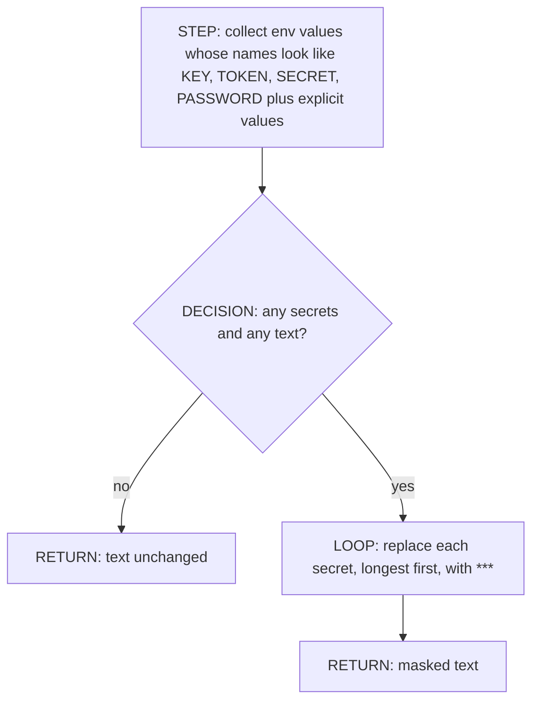

# Card: keep secrets out of everything you write

Code: `redact` in [src/llm_eval_kit/security.py](../../src/llm_eval_kit/security.py).
Tests: [tests/test_security.py](../../tests/test_security.py) plants a fake key, makes a mock server echo it in an
error body and in a model answer, and checks the CLI output and report JSON never contain it.

## The question

"How do you guarantee an API key never ends up in a CI log or an uploaded report?"

## How to catch it in an interview

Listen for: secrets in logs, compliance, "the report gets uploaded to S3". The answer: one choke point that every
writer goes through, fed by the secret values themselves, plus tests that plant a fake key.

## Flowchart

## Slips (what this change fixed)

- Error bodies from a provider can echo headers; `OpenAICompatibleProvider._post` masks its own key in the snippet.
- `report.to_dict()`, `summary()`, cache writes and CLI errors all pass through redaction.
- `repr()` of a provider shows model and URL, never the key.
- Values shorter than 8 characters are ignored, so `true` or `1` are not masked everywhere.

## Interviewer questions and how the code answers

| Question | Answer in the code |
|---|---|
| Why longest first? | If one secret contains another, masking the short one first leaves part of the long one visible. |
| Why match by value, not by pattern like `sk-...`? | Formats differ per vendor; the real value is the only sure match. |
| What if a key is not in env? | The provider passes it explicitly via `extra`. |

## Twists

- Also mask base64 or URL-encoded forms of each secret.
- GitHub Actions masks registered secrets in logs, but not in files you upload; this covers files.
