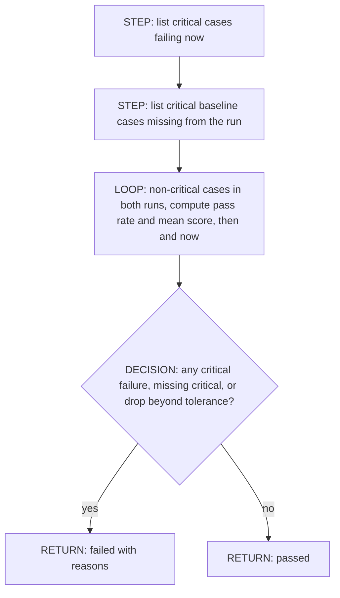

# Card: regression gate, strict and tolerant

Code: `evaluate_regression` in [src/llm_eval_kit/regression.py](../../src/llm_eval_kit/regression.py).
Tests: [tests/test_regression.py](../../tests/test_regression.py), including `TestCLIExitCodes`
(a seeded critical failure exits 1; a drop inside tolerance exits 0).

## The question

"Design a CI gate for a non-deterministic system. What fails the build, and what is allowed to wobble?"

## How to catch it in an interview

Listen for: flaky LLM tests, "a model update broke prod", baseline, golden set. The answer splits checks in two:
hard rules (security, schema, deterministic logic) that must pass every time, and quality scores that are compared
with a stored baseline and may drift inside a tolerance.

## Flowchart

## Slips (what this change fixed)

- Before: one global `pass_rate`; a security check failing and a wording change counted the same.
- A critical case fails the gate even if it also failed in the baseline. Critical means must pass, not "no worse".
- Deleting a critical case from the suite is caught (`missing_critical`).
- Quality metrics use only cases present in both runs, so adding new cases cannot hide a regression.
- `--update-baseline` refuses to record a baseline while critical cases fail.

## Interviewer questions and how the code answers

| Question | Answer in the code |
|---|---|
| Where does the baseline live? | In git (`examples/baselines/*.json`), slim and sorted so diffs are reviewable. |
| How do you mark critical? | `critical: true` or `check_type` in `critical_check_types` (`is_critical` in config.py). |
| How much drift is OK? | `regression.pass_rate_drop` and `mean_score_drop` in the suite, or `--tolerance-*` flags. |
| Floating point at the boundary? | A 1e-9 epsilon, so a drop exactly equal to the tolerance passes. |

## Twists

- Statistical gate: run each case N times and compare pass rates with a confidence interval instead of a fixed drop.
- Per-tag tolerances (stricter for `billing`, looser for `tone`).
- Require a reviewer approval on any PR that edits a baseline file (CODEOWNERS).
