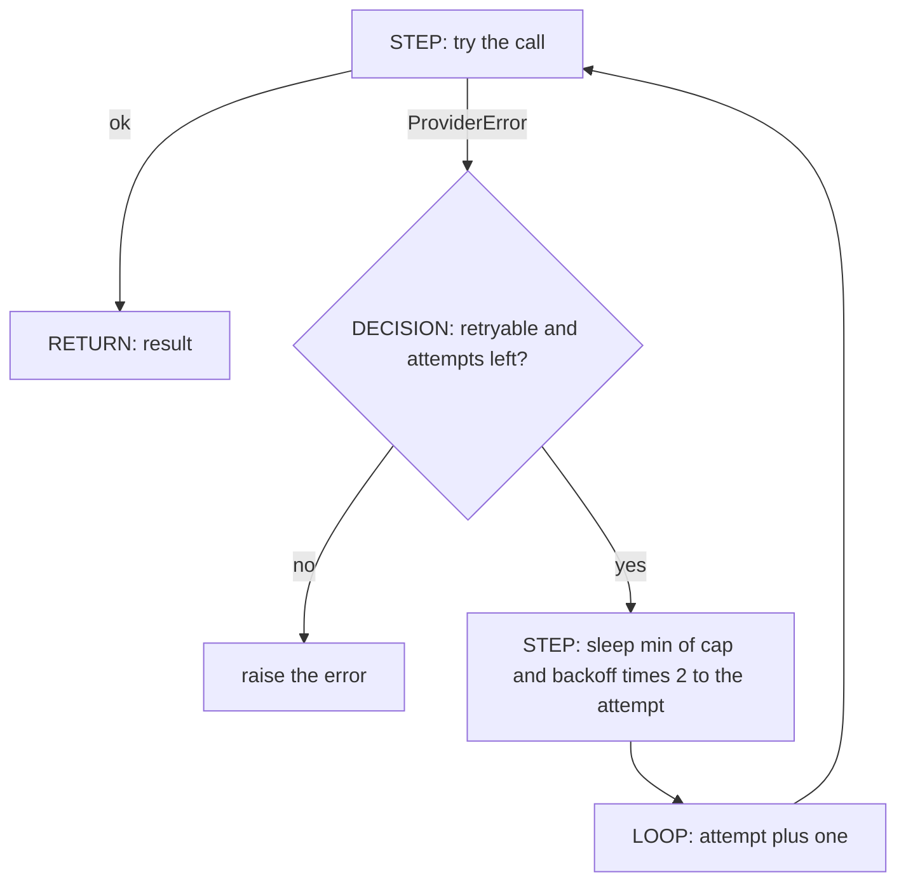

# Card: retry with capped backoff

Code: `call_with_retries` in [src/llm_eval_kit/reliability.py](../../src/llm_eval_kit/reliability.py).
Tests: `TestRetriesAndBudget` in [tests/test_cache_cost.py](../../tests/test_cache_cost.py), `test_retries_429_then_succeeds` and `test_400_is_not_retried` in [tests/test_providers.py](../../tests/test_providers.py).

## The question

"Your provider returns 429 under load. How do you retry without hammering it or looping forever?"

## How to catch it in an interview

Listen for: rate limit, flaky network, 5xx, "make it resilient". The answer has three parts:
only retry errors that can succeed later, wait longer each time, and stop after a fixed number of tries.

## Flowchart

## Slips (what this change fixed)

- Before: no retries at all; one 429 failed the whole CI run.
- The provider decides what is retryable (429, 408, 409, 5xx, timeouts, network errors). A 400 or 401 is raised at once, because trying again cannot fix a bad request or a bad key.
- `sleep` is injected, so the test checks the exact wait sequence without waiting.

## Interviewer questions and how the code answers

| Question | Answer in the code |
|---|---|
| Why not retry everything? | `if not err.retryable` raises at once; 400s would just burn quota. |
| What stops an infinite loop? | `attempt >= retries` raises after `retries + 1` tries. |
| Why cap the backoff? | `min(max_backoff_s, ...)` keeps a CI job from sleeping for minutes. |
| How do you test it fast? | `sleep=sleeps.append` records waits instead of sleeping. |

## Twists

- Add jitter: multiply the wait by a random factor in [0.5, 1.0] so parallel jobs do not retry in lockstep.
- Honour `Retry-After`: read it from the 429 response and use it instead of the computed wait.
- Bedrock uses botocore's own `standard` retry mode instead of this function (see `make_aws_client`).
